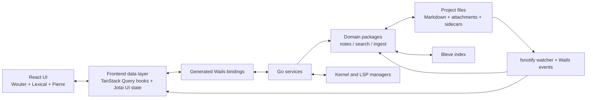

# AGENTS.md

Guidance for coding agents working in this repository (Codex, Claude Code, etc.).

## Project summary

Bytebook is a desktop note-taking app for developers built with **Wails v3**:

- **Go backend** under `internal/`
- **React + TypeScript frontend** under `frontend/`
- Notes are stored as **Markdown files on disk**
- Full-text search uses **Bleve**
- Code execution integrates **Jupyter kernels** (ZeroMQ)

Important: the repo uses a **local fork of Wails v3**. `go.mod` includes a `replace` pointing to `../wails/v3`, so the sibling `wails/` directory must exist for Go builds to work.

## Quick commands

### All checks in parallel (recommended)

```bash
bun check       # Run all frontend & backend checks + tests concurrently
bun check:fix   # Auto-fix formatting & lint issues then run checks
bun check:fe    # Frontend checks only (Prettier, ESLint, TSGO, Knip, Bun test)
bun check:be    # Backend checks only (Go deadcode, Go vet, Go tests)
```

### Go backend

```bash
go mod tidy

# All tests (cached)
gotestsum --format=pkgname --format-icons=hivis ./internal/...

# All tests (no cache)
gotestsum --format=pkgname --format-icons=hivis -- -count=1 ./internal/...

# Single package
go test ./internal/search/...
```

### Frontend

```bash
cd frontend
bun install

# Type-check (tsgo)
bun run tsgo

# Lint / format check
bun run lint:check
bun run format:check

# Unit tests
bun run test:unit
```

## Architecture

### Backend startup and package ownership

`internal/main.go` is the desktop entry point. At startup it:

1. Creates and loads the Bytebook project directory.
2. Opens the Bleve index behind `search.IndexHolder`.
3. Creates the Jupyter kernel manager, Python LSP manager, `fsnotify` watcher, directory-watch registry, and bulk-import coordinator.
4. Registers the Wails services from `internal/services/`.
5. Serves the embedded `frontend/dist` application, adding SPA fallback and project-local file middleware.
6. Starts file watching and the initial notes-tree indexing pass once the Wails runtime is ready.

Backend responsibilities are split as follows:

- `internal/services/` — the Wails RPC boundary. Services validate project-relative inputs and orchestrate the domain packages.
- `internal/notes/` — Markdown/file operations, the complete path listing, local media serving, `fsnotify` processing, and hidden metadata sidecars.
- `internal/search/` — Bleve mappings, queries, indexing, sorting, and saved searches. `IndexHolder` coordinates searches with index replacement.
- `internal/ingest/` — bounded background discovery, indexing, and watch registration for startup and newly imported folder trees.
- `internal/kernel_manager/` and `internal/jupyter_protocol/` — Jupyter process lifecycle and ZeroMQ messaging.
- `internal/lsp/` — per-note Pyright language-server processes used by Python code blocks.
- `internal/events/` — backend reactions to Wails events, including keeping the search index synchronized with file changes.
- `internal/config/` — project paths, persisted settings/kernel configuration, and shared backend response types.
- `internal/ui/` — native windows and application menus.

### Persistence and synchronization

The project data directory is currently macOS-specific: `~/Library/Application Support/Bytebook/`. Important subdirectories are:

- `notes/` — Markdown notes and arbitrary attachments. A file such as `foo.md` or `photo.png` may have a hidden `.<filename>.json` sidecar for tags and code-execution results.
- `settings/` — application settings.
- `search/` — the Bleve index and saved searches.
- `code/` — kernel descriptors and per-instance connection files under `code/.kernels/`.

The filesystem is the source of truth for the notes tree. Service mutations write to disk; the watcher batches file/folder events; backend event handlers update Bleve; frontend event hooks invalidate or reconcile TanStack Query data and in-memory UI models. Large startup or folder-import scans go through `BulkImportCoordinator` rather than fanning out watcher work.

### Frontend data flow

- `frontend/src/main.tsx` creates the global TanStack Query client. Query and mutation failures represented by `QueryError` are surfaced as toasts.
- `frontend/src/App.tsx` owns application-wide event synchronization, routing, the resizable/reorderable sidebar, and global dialog/context-menu/loading overlays.
- `frontend/src/hooks/` is the frontend data layer: hooks call generated Wails bindings, own query/mutation behavior, and subscribe to Wails events.
- `frontend/src/utils/query-keys.ts` is the source of truth for TanStack Query keys. TanStack Query owns backend/server state; Jotai atoms own local and cross-component UI state.
- Exported Go service methods generate TypeScript RPC bindings in `frontend/bindings/`. Regenerate them after changing a service signature or a bound model.
- Custom event names originate in `internal/util/events.go` and are mirrored by `frontend/src/utils/events.ts`. Payload registration is split across the Go package that owns each payload type so Wails can generate typed event bindings.

### Path conventions

- Routes, persisted settings, watcher payloads, and ordinary service arguments use slashless paths relative to `notes/`.
- The Pierre tree represents folders with a trailing slash. `FileTreeService.GetAllPaths` and frontend path adapters are the explicit tree boundary; normalize with the helpers in `frontend/src/utils/path.ts` instead of ad hoc string handling.
- Use the typed `FilePath` and `FolderPath` objects for frontend navigation and service-facing path work.

## Pages / routes (frontend)

Routes are wired in `frontend/src/App.tsx` using `wouter` + `routeUrls.patterns` (from `frontend/src/utils/routes.ts`). Key pages:

- `/notes/*` → `EditorWrapper`, which selects `NoteRenderer` for files and `FolderRenderer` for folders
- `/kernels/:kernelName` → `KernelInfo` (lazy-loaded)
- `/404` and `*` → `NotFound`
- `/` (`ROOT`) intentionally renders no main-page component. The initial window opens at `/?restore`, and `useRestoreLastVisitedOnLaunch` replaces it with the latest note/folder when available; manually opened windows remain at the root with the sidebar visible.

Layout note: `FileSidebar` visibility is toggled in `frontend/src/App.tsx` when a note is maximized. Full-text filtering is integrated into the file tree rather than a separate route.

## Key components (frontend)

- `frontend/src/components/editor-wrapper.tsx` (`EditorWrapper`): interprets the wildcard notes route and dispatches to the note editor, folder grid, loading state, or not-found page.
- `frontend/src/components/editor/index.tsx` (`NotesEditor`): composes the Lexical editor, toolbar, title, tags, linked mentions, and plugins for Markdown shortcuts, files, code execution, links, tables, drag/drop, and persistence. `OnChangePlugin` debounces the `SAVE_MARKDOWN_CONTENT` command; `SavePlugin` serializes Markdown/frontmatter plus code-result sidecar data through `NoteService`.
- `frontend/src/components/virtualized/virtualized-file-tree/index.tsx` (`VirtualizedFileTree`): despite the legacy component name, the sidebar tree is built with `@pierre/trees`, not `react-virtuoso`. `useAllPaths()` supplies the canonical filesystem snapshot, while a long-lived Pierre model owns expansion, selection, rename, create, and drag/drop interaction state. Watcher events and completed path refetches reconcile that model.
- `frontend/src/components/virtualized/virtualized-file-tree/filtered-file-tree.tsx` (`FilteredFileTree`): creates a separate ephemeral, navigation-only Pierre model for advanced/Bleve filter results. The canonical tree stays mounted and hidden so its state and synchronization remain active.
- `frontend/src/components/folder-renderer/` and `frontend/src/components/virtualized/virtualized-list/`: folder contents and reusable sidebar lists still use `react-virtuoso`; do not infer that implementation for the Pierre file tree.

## Mermaid diagram (high level)



## Working conventions

- Prefer **small, surgical diffs**; avoid drive-by refactors.
- The repo uses **jj (Jujutsu)** for version control, not raw git commands.
- Do not prioritize backwards compatibility — this is not a released product.
- Keep event names in `internal/util/events.go` as the source of truth.
- If you change backend services, ensure generated bindings stay in sync (Wails binding generation).

## Rules (`.agents/rules/`)

Detailed, path-scoped coding conventions live in `.agents/rules/` and load automatically when working on matching files (`.claude/rules` is a symlink to it for Claude Code, same as `.claude/skills`):

- `frontend-react.md` — React/TypeScript style: component & prop conventions, no `useCallback`/`useMemo`, Jotai atom placement, Tailwind/`cn()`, path utilities
- `frontend-data-layer.md` — bindings via query hooks, `queryKeys` factory, `QueryError` handling, Wails event constants
- `frontend-testing.md` — `bun:test` unit tests, Playwright e2e, binding regeneration for the mock harness
- `go-backend.md` — `BackendResponse` shape, error wrapping, logging, event emission, test style
