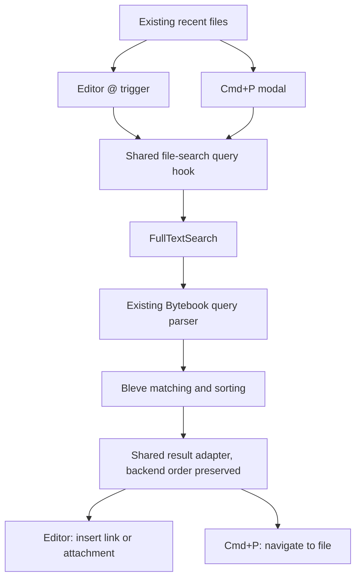

# Quick Open and command palette

Status: implemented across six commits, verified 2026-09-17. The user's existing change to `frontend/src/components/virtualized/virtualized-file-tree/tree-search-input.tsx` remains uncommitted and untouched.

## Execution record

| Commit     | Result                                                                            |
| ---------- | --------------------------------------------------------------------------------- |
| `xnttnpul` | Distinguish search failures from empty results; regenerate Wails bindings.        |
| `vnsmysoy` | Share the file-picker query, recent filtering, and safe excerpt rendering.        |
| `pumyxvwu` | Add Cmd+P, native event routing, file navigation, and compact modal.              |
| `yxmypxmv` | Add Cmd+Shift+P, explicit command mode, and shared Settings action.               |
| `sptwsxpu` | Add explicit note creation with destination selection and pending/error handling. |
| `vwywrxqk` | Add saved searches, global invalidation, and activation-time query lookup.        |

The final layout follows the user's refinement: no visible Quick Open heading or close button, 28 px rows without excerpts and 44 px rows with one excerpt, inline parent paths, and a compact footer. Escape and outside-click dismissal remain available; creation cannot dismiss while its write is pending. The dialog retains an accessible name.

Loading refinement: Quick Open opts into TanStack Query's previous-data placeholder, keeping the existing results through the 50 ms debounce and the next request. Before the first response, recent files stay visible. The “Searching…” message and spinner are removed; the results menu exposes `aria-busy` while updating. “Search all results” is disabled until the displayed page belongs to the completed query. The editor picker keeps its existing loading behavior. Verification: all 19 palette tests, all 292 frontend unit tests, TypeScript, and targeted lint pass. The controlled-response regression verifies previous rows remain visible until replacement arrives.

Revision details: Backspace/Delete stop at the modal capture boundary so Autocomplete cannot replay them into the results menu or outer navigation handlers; native input deletion remains enabled. The shared file-filter info icon and `SearchHelpSections` are used in Quick Open, including sort syntax. The help button opts out of SearchField's clear-button context and its tooltip is portaled inside the modal. Commands/Files and Refresh buttons are removed; Retry appears only on search failure. Native verification opened an existing note, edited and cleared a query without changing its route, and confirmed both repeated shortcuts close the palette.

Implementation adjustments: explicit command callbacks replace the draft command-ID dispatcher. Saved searches use those callbacks and resolve the latest TanStack Query data on activation; a second action variant would duplicate dispatch. Note creation keeps mutation state in the modal owner so pending dismissal guards remain active. These changes preserve the ownership and behavior in the plan below.

Validation after the requested revisions: 19 palette browser tests pass, covering syntax forwarding, backend ordering, recents, window guards, shortcut toggles, deletion-key isolation, help tooltip, Settings/sidebar focus handoff, errors/retry, note creation, pending submission, saved-search updates, stale responses, and compact dark layout. The 23 editor insertion tests passed after migrating the full-text response fixture. Real Bleve service tests cover filename, tags/type, phrases/AND, links, language, sort order, pagination, empty results, and index failure. Production frontend and native Go builds pass. Native checks verified both shortcuts in two windows, real `f:chapter` results, and nonempty Escape dismissal; closing the second window showed the original window had not opened a palette.

Prior full browser suite (before these interaction revisions): `bun run test:e2e:ci --workers=4` completed with 100 passed and 25 failed (4.5 minutes). All 16 palette tests and all 23 content-insertion tests passed. Failures are in unchanged drag-ghost, link-editing, Markdown, and tag specs: their fixtures omit `GetAllPaths`, leaving the unchanged `EditorWrapper` waiting for the canonical filesystem snapshot. Trace snapshots show the loading screen instead of an editor. Comparing these specs and `EditorWrapper` to the pre-feature revision confirms no feature diff in them; a separate baseline checkout was not run. These fixture failures remain outside this feature.

`bun check` passes lint, TypeScript, Knip, frontend/backend unit tests, Go vet, and Go deadcode. The formatting gate still fails on six pre-existing files outside the feature; these were left untouched.

A temporary on-disk Bleve fixture indexed 10,000 and 50,000 synthetic engineering notes (about 600 bytes each), reopened each index, and measured the first call plus five warm calls through `SearchService.FullTextSearch` with page size 15. The fixture was removed after measurement. Times below are milliseconds. First calls are after reopening, not an OS disk-cache flush; these are synthetic backend timings, not native end-to-end latency.

| Documents | Query                  | First | Warm mean |
| --------- | ---------------------- | ----: | --------: |
| 10,000    | `redis`                |  2.53 |      2.16 |
| 10,000    | `f:note-00001`         |  2.64 |      2.74 |
| 10,000    | `#work AND redis`      |  2.89 |      2.40 |
| 10,000    | `"cache invalidation"` |  0.38 |      0.27 |
| 50,000    | `redis`                |  8.18 |      6.03 |
| 50,000    | `f:note-00001`         |  5.43 |      6.35 |
| 50,000    | `#work AND redis`      |  9.45 |      8.69 |
| 50,000    | `"cache invalidation"` |  0.64 |      0.58 |

The shared debounce remains 50 ms. VoiceOver speech output, zoom/long-path visual cases, and instrumented native end-to-end timing have not been verified. Browser accessibility/focus assertions and native accessibility-tree inspection are the available evidence.

## Product direction and required search behavior

**Cmd+P is an application-wide version of the editor's `@` file picker.** It uses the same Bytebook search syntax, backend parser, Bleve matching, ranking, and explicit sort options. Selecting a result opens the file; selecting a result in `@` continues to insert a link or attachment.

There is no `matchPaletteText`, local filename ranking, recent/pin boosting of search hits, local fuzzy-search library, or separate filename/content result merge. Bleve owns all document search ordering. Empty input shows recent files, matching the editor picker; this is a history view, not a search ranking rule.

Keep Cmd+Shift+P as a separate command mode in the same modal. Each shortcut opens its mode when closed; either shortcut closes an already-open palette. No mode-switch buttons are shown. Do not consume leading characters from Cmd+P's search input for palette modes. In particular, `@` already means linked-reference search and `#` already means tags in the backend language; they must not become heading/tag mode switches.

The core search experience is complete after commits 1–3. Commands, creation, and saved-search access follow in commits 4–6. Content search is part of Cmd+P from its first functional commit, not a later enhancement.

### Existing implementation verified

- `FilePickerMenuPlugin` detects the editor's `@` trigger with whitespace and punctuation allowed, then calls `useFilePickerSearchQuery(searchQuery ?? '')`.
- That hook calls `FullTextSearch(query, [], 15)`. The result adapter preserves backend ordering and returns notes and attachments; it currently drops folders.
- `FullTextSearch` calls `BuildBooleanQueryFromUserInput(query, 1)` and `CreateSearchRequest`. The request uses the requested sort, or `-_score` then `_id` by default.
- Existing parser features include `f:` / `file:`, `#tag`, `@link`, `t:` / `type:`, `l:` / `lang:`, quoted phrases, AND/OR, and sort expressions. Reuse the actual parser and its tests; do not reconstruct the grammar in TypeScript.
- Empty editor input displays recent files, excluding the current note. Cmd+P follows this policy, including exclusion of the current file from search results, while preserving the relative backend order of remaining results.
- `FullTextSearch` currently represents backend failure as an empty page. Commit 1 fixes this before Cmd+P depends on it.

### Interaction contract

| Situation                 | Behavior                                                                                                                                                   |
| ------------------------- | ---------------------------------------------------------------------------------------------------------------------------------------------------------- |
| Empty input               | Recent files, excluding the current file. No search RPC. An empty history explains how to search; no invented alphabetical fallback.                       |
| Nonempty input            | Send the query to the shared search hook, including one-character queries. Preserve syntax and backend order.                                              |
| Filename/content matching | One list of backend results with labels, parent paths, and available excerpts. No client-side relevance tiers.                                             |
| Search syntax             | Examples such as `f:redis`, `#work AND type:note`, and quoted phrases pass unchanged to the existing backend parser.                                       |
| Explicit sorting          | Preserve the backend order exactly; do not move recent or pinned documents ahead of it.                                                                    |
| Result scope              | Notes and supported attachments, matching `@`. Folder results require a later shared adapter/backend decision; do not silently treat folders as files.     |
| Activation                | Arrow keys select; Enter/pointer activation opens the file. Merely highlighting never navigates.                                                           |
| Dismissal                 | Escape/outside click returns focus; IME composition must not activate a result.                                                                            |
| Loading/error             | Distinct loading, zero-result, and failure states. Retry retries the same query. No silent fallback to differently ranked local matching.                  |
| Query replacement         | Keep the previous results visible and actionable during debounce and fetching; replace them when the current query completes. Ignore late older responses. |
| Repeated opener           | Either shortcut closes the open palette. Reopening after dismissal starts fresh; pending creation keeps its write guard.                                   |
| Existing modal            | Ignore requests during form/settings/blocking loading dialogs. Close a context menu before opening. Close the palette if another modal takes over.         |
| Sidebar                   | Search and file activation do not change its filter. Explicit “Search all results” and saved-search actions transfer the query and focus the sidebar.      |
| Creation                  | Separate “New Note…” action; a query expression is never automatically treated as a filename.                                                              |

Use existing accent colors, icons, loader, fields, and buttons. Per the latest user direction, omit the visible Quick Open heading and close button; retain an accessible dialog label and dismiss through Escape/outside click. Keep rows compact: filename and parent path share a line, with at most one excerpt line underneath. The modal is approximately `min(40rem, 90vw)` with a bounded scrolling area. Request up to 100 results for Quick Open; the editor picker retains its 15-result default. When additional hits exist, offer “Search all results” using the existing sidebar filter rather than inventing a second pagination UX. Explain that the picker displays a limited page; excluding the current file can reduce its visible count.

## Architecture and alternatives

| Solution                                          | Decision                                                                                                                                         |
| ------------------------------------------------- | ------------------------------------------------------------------------------------------------------------------------------------------------ |
| Shared Bleve search hook with `@`                 | Selected: consistent syntax, ranking, result adapter, and query lifecycle.                                                                       |
| Separate local matcher                            | Rejected for this feature: it produces a second search behavior and cannot represent the backend language faithfully.                            |
| Independent palette-only RPC/query implementation | Avoid: extract one shared query factory/hook and keep only the UI and activation adapters separate.                                              |
| Reuse Lexical's typeahead popup itself            | Reuse search logic and visual conventions, not its editor plugin lifecycle. Cmd+P must work with no editor mounted.                              |
| React Aria Autocomplete + Menu                    | Selected: existing dependency and public command-palette/virtual-focus pattern. Supply ordered items without another client filter in file mode. |
| New cmdk/Fuse/provider framework                  | Unnecessary for the selected requirements.                                                                                                       |
| Separate native window/global shortcut            | Out of scope: native menu accelerators open a modal in the current Wails window.                                                                 |

VS Code provides a familiar distinction between file navigation and command execution, but Bytebook's existing `@` picker is the primary behavioral reference. React Aria supports the modal's keyboard/focus interaction without owning search semantics. [VS Code shortcuts](https://code.visualstudio.com/docs/reference/default-keybindings), [React Aria Autocomplete](https://react-aria.adobe.com/Autocomplete).



### Ownership and lifecycle

- `App` owns the palette controller and recent-route recording. Move the existing recording effect from `RecentAccordion` to a route hook mounted in `App`; the list must not depend on a sidebar component being mounted.
- `src/atoms.ts` holds only open mode. Input and creation state stay local to the palette. React Query owns search pages. Do not copy paths/results into another atom or register dynamic providers.
- `hooks/search.tsx` owns the shared query factory, response checks, adapter, and query lifecycle. Both UIs use it, with distinct activation functions. Bindings are never called directly from components.
- Use `useAllPaths` for recent-item validation, path type information, and creation destinations. It is not a search engine and must not reorder/filter nonempty-query results into a different search policy. A stale index hit may navigate to the existing not-found handling.
- The shared recent-file adapter can prune missing history entries when a successful canonical snapshot is available. It excludes folders/current file and preserves recent order for both UIs.
- Nonempty search is debounced 50 ms in the shared hook, including the editor picker. Pass the raw string to the backend; use `.trim()` only to detect blank input. Keep one-character searches. Do not lowercase, normalize, strip prefixes, or parse the language on the client.
- Query keys include the raw query and requested page size. Use `retry: false`, `staleTime: 0`, and short cache retention. Quick Open retains previous results during debounce and fetching; the editor picker returns no actionable result page until raw and debounced strings match.
- A new session refreshes search data. Relevant file/tag events invalidate the shared search-key prefix while consumers are open. Backend indexing may lag those events; provide Retry on failure and do not promise immediate index freshness. No permanent polling or new indexing completion event is included.
- Close/unmount disables new work. A late in-flight request may finish into its own cache entry; it must not reopen the modal or trigger insertion/navigation. Do not promise RPC cancellation unless the generated cancellable transport is wired and tested.
- Use a palette-specific modal shell with existing React Aria styles. Generic `Dialog` currently owns form submission and sidebar-selection cleanup, which the picker should not inherit.
- Display existing result highlights and code/file metadata as appropriate. Render excerpts as inert text plus known highlight marks; do not introduce raw HTML rendering. Keep this display transformation separate from result ordering.
- Preserve existing backend query semantics. If ranking or a syntax case needs improvement, change and test the shared Go parser/search request so `@`, Cmd+P, and other consumers benefit consistently.

## Execution contract

Follow the multi-commit skill: implement, verify, inspect, and commit **one entry at a time**, then report its ID and the next entry. Repository instructions override the skill's raw Git examples: use Jujutsu.

All commands below run from `/Users/etesam/Coding/bytebook` unless marked otherwise. Before implementation, inspect `jj status`, `jj diff`, and applicable rules again. Preserve the user's modified tree-search input. This plan file is documentation, not evidence that the feature is implemented.

After each commit's focused tests, run its complete affected-layer gate: `bun check:fe`, `bun check:be`, or `bun check` for cross-boundary changes. Run generated-binding preparation after service/event changes with `bun --cwd frontend run e2e:prepare`; do not use `-ts`. Review only generated changes caused by that entry and include them with the entry. The E2E harness discovers RPC method IDs from `.js` bindings.

Inspect `jj diff` and make a path-scoped commit using `jj commit -m '<title>' <only this entry's paths>`. Never accidentally include the existing tree-search-input change. If an unrelated gate fails, report the exact failure and establish its baseline; do not reformat unrelated files to clear it. No publishing or pushing is part of this plan.

Diffs below specify the key implementation contracts and integration changes. They are planning excerpts, not a claim that every import, style, test fixture, and generated line is already a compilable patch. Each entry lists all intended handwritten files; generated files must be reviewed after the actual generator runs.

## Commit 1: `fix(search): distinguish full-text failures from empty results`

**Rationale:** Establish the response contract shared by the editor picker and Cmd+P, while keeping this independently testable through the current editor file picker.

**Files:** Modify [search_service.go](/Users/etesam/Coding/bytebook/internal/services/search_service.go), [search.tsx](/Users/etesam/Coding/bytebook/frontend/src/hooks/search.tsx), [mock-responses.ts](/Users/etesam/Coding/bytebook/frontend/tests/e2e/utils/mock-responses.ts), and [content-insertion.spec.ts](/Users/etesam/Coding/bytebook/frontend/tests/e2e/specs/editor/content-insertion.spec.ts). Create [search_service_test.go](/Users/etesam/Coding/bytebook/internal/services/search_service_test.go) if still absent at execution. Regenerate [searchservice.js](/Users/etesam/Coding/bytebook/frontend/bindings/github.com/etesam913/bytebook/internal/services/searchservice.js) and [config/models.js](/Users/etesam/Coding/bytebook/frontend/bindings/github.com/etesam913/bytebook/internal/config/models.js), plus generator-required model/barrel changes revealed by the diff.

```diff
--- a/internal/services/search_service.go
+++ b/internal/services/search_service.go
@@
-func (s *SearchService) FullTextSearch(searchQuery string, searchAfter []string, pageSize *int) search.FullTextSearchPage {
+func (s *SearchService) FullTextSearch(searchQuery string, searchAfter []string, pageSize *int) config.BackendResponseWithData[search.FullTextSearchPage] {
@@
-        return search.FullTextSearchPage{
-            Results: []search.SearchResult{},
+        return config.BackendResponseWithData[search.FullTextSearchPage]{
+            Success: false,
+            Message: "Could not search notes. Please try again.",
         }
@@
-    return search.FullTextSearchPage{
+    page := search.FullTextSearchPage{
         Results:         processedResults,
         NextSearchAfter: nextSearchAfter,
         HasMore:         hasMore,
         Total:           res.Total,
     }
+    return config.BackendResponseWithData[search.FullTextSearchPage]{
+        Success: true,
+        Data: page,
+    }
--- a/frontend/src/hooks/search.tsx
+++ b/frontend/src/hooks/search.tsx
@@
-type FullTextSearchPageResponse = Awaited<ReturnType<typeof FullTextSearch>>;
+type FullTextSearchPageResponse = Awaited<ReturnType<typeof FullTextSearch>>['data'];
@@
-      const page = await FullTextSearch(searchQuery, [], FILE_PICKER_PAGE_SIZE);
-      return mapFullTextSearchResults(page.results);
+      const response = await FullTextSearch(searchQuery, [], FILE_PICKER_PAGE_SIZE);
+      if (!response.success) throw new QueryError(response.message);
+      return mapFullTextSearchResults(response.data.results);
```

Wrap current page fixtures in `{ success: true, message: '', data: page }`; update both content-insertion overrides as well as the shared mock. Search all call sites after regeneration to catch inferred type changes. Preserve pagination fields and successful zero-hit behavior.

**Verification:**

```sh
go test ./internal/services -run TestFullTextSearch
bun --cwd frontend run e2e:prepare
cd frontend
bunx playwright test -c tests/e2e/playwright.config.ts tests/e2e/specs/editor/content-insertion.spec.ts
cd ..
bun check
```

Use a real temporary Bleve index for success, zero hits, and cursor pagination. Force a search error through a closed index and assert `success: false` with a safe message. Add the error-contract regression first and verify it fails against the original response. Confirm the editor picker still inserts a selected link and surfaces an actual search error instead of implying no matches.

## Commit 2: `refactor(search): share file-picker queries and result state`

**Rationale:** Establish one search implementation through the existing editor picker before adding another UI. This commit has an existing production consumer and independently verifiable behavior.

**Files:** Modify [search.tsx](/Users/etesam/Coding/bytebook/frontend/src/hooks/search.tsx), [query-keys.ts](/Users/etesam/Coding/bytebook/frontend/src/utils/query-keys.ts), [file-picker.tsx](/Users/etesam/Coding/bytebook/frontend/src/components/editor/plugins/file-picker.tsx), and [content-insertion.spec.ts](/Users/etesam/Coding/bytebook/frontend/tests/e2e/specs/editor/content-insertion.spec.ts). Create [file-picker-results.ts](/Users/etesam/Coding/bytebook/frontend/src/utils/file-picker-results.ts), [file-picker-results.test.ts](/Users/etesam/Coding/bytebook/frontend/src/utils/file-picker-results.test.ts), [search-excerpt.ts](/Users/etesam/Coding/bytebook/frontend/src/utils/search-excerpt.ts), and [search-excerpt.test.ts](/Users/etesam/Coding/bytebook/frontend/src/utils/search-excerpt.test.ts). Excerpt helpers must be consumed by the editor in this commit; modify [dropdown-picker.tsx](/Users/etesam/Coding/bytebook/frontend/src/components/dropdown/dropdown-picker.tsx) only as needed to accept inert React highlight content instead of raw HTML. Inspect its other consumers before changing its prop contract.

```diff
--- a/frontend/src/utils/query-keys.ts
+++ b/frontend/src/utils/query-keys.ts
@@
-  filePickerFullTextSearch: (searchQuery: string) =>
-    ['file-picker-full-text-search', searchQuery] as const,
+  fileSearchAll: () => ['file-search'] as const,
+  fileSearch: (query: string, pageSize: number) =>
+    ['file-search', query, pageSize] as const,
--- a/frontend/src/hooks/search.tsx
+++ b/frontend/src/hooks/search.tsx
@@
 const searchQueries = {
+  files: ({ query, pageSize }: { query: string; pageSize: number }) =>
+    queryOptions({
+      queryKey: queryKeys.fileSearch(query, pageSize),
+      queryFn: async () => {
+        const response = await FullTextSearch(query, [], pageSize);
+        if (!response.success) throw new QueryError(response.message);
+        return {
+          results: mapFullTextSearchResults(response.data.results),
+          hasMore: response.data.hasMore,
+        };
+      },
+      retry: false,
+      staleTime: 0,
+      gcTime: 60_000,
+      refetchOnWindowFocus: false,
+    }),
@@
+export function useFileSearchQuery({
+  query,
+  enabled,
+}: { query: string; enabled: boolean }) {
+  const debouncedQuery = useDebouncedValue(query, 50);
+  const hasQuery = query.trim().length > 0;
+  const isCurrentQuery = query === debouncedQuery;
+  const result = useQuery({
+    ...searchQueries.files({ query: debouncedQuery, pageSize: 15 }),
+    enabled: enabled && hasQuery && isCurrentQuery,
+  });
+  return {
+    ...result,
+    data: enabled && hasQuery && isCurrentQuery ? result.data : undefined,
+    isError: enabled && hasQuery && isCurrentQuery && result.isError,
+    isSearching: enabled && hasQuery && (!isCurrentQuery || result.isFetching),
+  };
+}
```

Replace `useFilePickerSearchQuery` with this shared hook and update its existing consumer in the same commit. The editor passes `enabled: searchQuery !== null`, reads `data?.results`, and uses the explicit searching/error state rather than equating missing data with zero results. Update its early return so loading and failure are visible even with zero options; a failed query must not display “No results found”. Extract recent-file selection into the shared pure adapter, preserving history order and current-note exclusion. Search-result adaptation must be order-preserving; no comparator or matching helper is added.

Add a shared event-invalidation hook for the search-key prefix while a picker is active. Both consumers may subscribe while active; simultaneous invalidation should coalesce through React Query. Do not tie shared search invalidation to the sidebar's filter query key.

**Verification:**

```sh
cd frontend
bun test src/utils/file-picker-results.test.ts src/utils/search-excerpt.test.ts
bunx playwright test -c tests/e2e/playwright.config.ts tests/e2e/specs/editor/content-insertion.spec.ts
cd ..
bun check:fe
```

Assert exact backend order, unchanged syntax/RPC arguments, empty-query recent behavior, one-character search, current-file exclusion, syntax punctuation/whitespace, immediate removal of old actionable results, controlled out-of-order responses, error versus zero hits, and unchanged link/attachment insertion. Pure excerpt tests cover known marks and literal HTML. Browser mocks prove forwarding/presentation; real Bleve tests in commit 3 prove syntax semantics.

## Commit 3: `feat(navigation): add Quick Open using the shared Bleve file search`

**Rationale:** Deliver a usable navigation feature and its native entry point together. Search behavior already comes from the shared editor-picker hook; this entry verifies navigation, native entry points, and focus without command dispatch.

**Files:** Create [palette/index.tsx](/Users/etesam/Coding/bytebook/frontend/src/components/command-palette/index.tsx), [use-palette-results.ts](/Users/etesam/Coding/bytebook/frontend/src/components/command-palette/hooks/use-palette-results.ts), and [command-palette.spec.ts](/Users/etesam/Coding/bytebook/frontend/tests/e2e/specs/command-palette.spec.ts). Modify [types.ts](/Users/etesam/Coding/bytebook/frontend/src/types.ts), [atoms.ts](/Users/etesam/Coding/bytebook/frontend/src/atoms.ts), [App.tsx](/Users/etesam/Coding/bytebook/frontend/src/App.tsx), [routes.tsx](/Users/etesam/Coding/bytebook/frontend/src/hooks/routes.tsx), [recent-accordion.tsx](/Users/etesam/Coding/bytebook/frontend/src/components/file-sidebar/recent-accordion.tsx), [events.ts](/Users/etesam/Coding/bytebook/frontend/src/utils/events.ts), [events.go](/Users/etesam/Coding/bytebook/internal/util/events.go), [application_menu.go](/Users/etesam/Coding/bytebook/internal/ui/menus/application_menu.go), and generated [eventdata.d.ts](/Users/etesam/Coding/bytebook/frontend/bindings/github.com/wailsapp/wails/v3/internal/eventdata.d.ts).

```diff
--- a/frontend/src/atoms.ts
+++ b/frontend/src/atoms.ts
@@
+// Holds the open palette mode; null means the palette is closed.
+export const commandPaletteModeAtom = atom<'files' | 'commands' | null>(null);
--- a/frontend/src/types.ts
+++ b/frontend/src/types.ts
@@
+export type PaletteAction = {
+  kind: 'open-path';
+  path: FileOrFolderPath;
+};
+export type PaletteItem = {
+  id: string;
+  label: string;
+  description: string;
+  action: PaletteAction;
+};
--- a/frontend/src/App.tsx
+++ b/frontend/src/App.tsx
@@
   useHistoryNavigationEvents();
+  useRecordRecentItem();
@@
         <Dialog />
+        <CommandPalette />
--- a/internal/util/events.go
+++ b/internal/util/events.go
@@
     EventSearchNote          = "search:note"
+    EventQuickOpen           = "navigation:quick-open"
@@
     application.RegisterEvent[application.Void](EventSearchNote)
+    application.RegisterEvent[application.Void](EventQuickOpen)
--- a/frontend/src/utils/events.ts
+++ b/frontend/src/utils/events.ts
@@
 export const SEARCH_NOTE = 'search:note';
+export const QUICK_OPEN = 'navigation:quick-open';
--- a/internal/ui/menus/application_menu.go
+++ b/internal/ui/menus/application_menu.go
@@
     sub := item.GetSubmenu()
+    quickOpen := sub.Add("Quick Open…")
+    quickOpen.SetAccelerator("cmdorctrl+p")
+    quickOpen.OnClick(func(ctx *application.Context) {
+        if win := app.Window.Current(); win != nil {
+            win.EmitEvent(util.EventQuickOpen)
+        }
+    })
```

The menu insertion belongs specifically inside `configureViewMenu`. Move the existing route/history effect unchanged into `useRecordRecentItem()` in `hooks/routes.tsx`; `RecentAccordion` reads `mostRecentItemsAtom` only. Do not create a second history list or increase its existing ten-item capacity.

`usePaletteResults()` uses `useFileSearchQuery({ query, enabled: true })` while the modal body is mounted. Empty input uses the shared recent-file adapter. A nonempty query uses `data.results` in order, excludes the current file with the same shared policy as `@`, and maps each hit to an `open-path` action. Do not add pins, filename tiers, or a second filter.

Reuse the shared excerpt helper and existing file icons. Add “Search all results” when `hasMore` is true; after closure, transfer the untouched query to `treeFilterQueryAtom`, reveal the sidebar, and request `focusTreeFilterInputAtom`.

The body follows this public composition, supplying backend-ordered items rather than letting a second filter reorder them:

```diff
+++ b/frontend/src/components/command-palette/index.tsx
+<ModalOverlay isOpen={isOpen} onOpenChange={onOpenChange} isDismissable>
+  <Modal>
+    <AriaDialog aria-label="Quick Open">
+      <Autocomplete inputValue={query} onInputChange={setQuery}>
+        <AppSearchField autoFocus maxLength={512} aria-label="Search notes and attachments" />
+        <Menu items={items} onAction={activate} aria-label="Results">
+          {(item) => (
+            <MenuItem id={item.id} textValue={item.label}>
+              <Text slot="label">{item.label}</Text>
+              <Text slot="description">{item.description}</Text>
+            </MenuItem>
+          )}
+        </Menu>
+      </Autocomplete>
+    </AriaDialog>
+  </Modal>
+</ModalOverlay>
```

The controller uses `useWailsEvent(QUICK_OPEN, ...)` and `isEventInCurrentWindow()` before opening. Recheck modal guards after the asynchronous window lookup. Use a ref to focus an already-open input. Delegate focus/selection mechanics to React Aria; configure and verify first-result activation using its public behavior. On cancellation restore the previous editor/control focus. On navigation, close then focus the destination using its normal focus behavior; do not restore focus to an unmounted editor.

**Verification:**

```sh
bun --cwd frontend run e2e:prepare
cd frontend
bunx playwright test -c tests/e2e/playwright.config.ts tests/e2e/specs/command-palette.spec.ts
cd ..
bun check
```

Browser cases: Wails event opens only its window; previous file opens with Enter; syntax reaches `FullTextSearch` unchanged; backend result order survives; current-file exclusion matches `@`; snippets are inert; typing/arrows do not navigate; Escape restores focus; root/404/maximized entry; failure/Retry; old queries cannot activate; a stale hit follows normal not-found routing; modal guards; and Search All Results transfers the exact query after closure.

Add real-Bleve parity cases to [search_service_test.go](/Users/etesam/Coding/bytebook/internal/services/search_service_test.go) for representative existing filename, tag, type, quote, Boolean, link/language, and sort syntax using deterministic indexed fixtures. These exercise `FullTextSearch`, not a mock parser. Run `go test ./internal/services -run TestFullTextSearch` and `go test ./internal/search` before the root gate. Avoid assuming syntax examples beyond what the parser currently supports; any uncovered parser defect must be reported and fixed at that shared boundary.

Native smoke test must verify Cmd+P, the View menu item, key repeat, focus from editor/code blocks, and two windows. Mocked browser events do not prove native accelerators work.

## Commit 4: `feat(commands): add contextual command mode to Quick Open`

**Rationale:** Introduce action execution separately from navigation and consolidate only existing actions that the palette needs.

**Files:** Create [use-palette-commands.tsx](/Users/etesam/Coding/bytebook/frontend/src/components/command-palette/hooks/use-palette-commands.tsx). Modify [palette/index.tsx](/Users/etesam/Coding/bytebook/frontend/src/components/command-palette/index.tsx), [use-palette-results.ts](/Users/etesam/Coding/bytebook/frontend/src/components/command-palette/hooks/use-palette-results.ts), [types.ts](/Users/etesam/Coding/bytebook/frontend/src/types.ts), [dialogs.tsx](/Users/etesam/Coding/bytebook/frontend/src/hooks/dialogs.tsx), [project-settings.tsx](/Users/etesam/Coding/bytebook/frontend/src/hooks/project-settings.tsx), [settings.tsx](/Users/etesam/Coding/bytebook/frontend/src/components/buttons/settings.tsx), [events.ts](/Users/etesam/Coding/bytebook/frontend/src/utils/events.ts), [events.go](/Users/etesam/Coding/bytebook/internal/util/events.go), [application_menu.go](/Users/etesam/Coding/bytebook/internal/ui/menus/application_menu.go), [command-palette.spec.ts](/Users/etesam/Coding/bytebook/frontend/tests/e2e/specs/command-palette.spec.ts), and generated [eventdata.d.ts](/Users/etesam/Coding/bytebook/frontend/bindings/github.com/wailsapp/wails/v3/internal/eventdata.d.ts).

First command set: Open Settings; Toggle Sidebar; Search All Notes; Go Back; Go Forward. Show relevant existing shortcut text, including Bytebook's current Cmd+S for Toggle Sidebar. New Note arrives in commit 5. Avoid editor selection commands, kernel execution, deletion, and bulk moves in this first list.

```diff
--- a/frontend/src/types.ts
+++ b/frontend/src/types.ts
@@
+export type PaletteCommandId =
+  | 'open-settings'
+  | 'toggle-sidebar'
+  | 'search-all-notes'
+  | 'go-back'
+  | 'go-forward';
 export type PaletteAction = {
   kind: 'open-path';
   path: FileOrFolderPath;
-};
+} | { kind: 'command'; command: PaletteCommandId };
--- a/internal/util/events.go
+++ b/internal/util/events.go
@@
+    EventCommandPalette = "commands:open"
@@
+    application.RegisterEvent[application.Void](EventCommandPalette)
--- a/frontend/src/utils/events.ts
+++ b/frontend/src/utils/events.ts
@@
+export const COMMAND_PALETTE_OPEN = 'commands:open';
--- a/frontend/src/hooks/dialogs.tsx
+++ b/frontend/src/hooks/dialogs.tsx
@@
+export function useOpenSettingsDialog() {
+  const setDialogData = useSetAtom(dialogDataAtom);
+  return () => setDialogData({
+    isOpen: true,
+    isPending: false,
+    title: 'Settings',
+    dialogClassName: 'w-[min(55rem,90vw)] rounded-2xl',
+    children: () => <SettingsDialog />,
+    onSubmit: async () => true,
+  });
+}
```

Replace both SettingsButton's inline dialog setup and `useProjectSettings`' settings-event setup with this shared hook. Keep imports acyclic: the dialog hook can render SettingsDialog but must not import `hooks/project-settings` directly. Add a native View item “Command Palette…” with `shift+cmdorctrl+p`, using the same current-window emission pattern as commit 3.

Definitions are built in `usePaletteCommands()` with hook-provided actions. `search-all-notes` sets `isFileMaximizedAtom` false and requests `focusTreeFilterInputAtom`; it does not overwrite an existing filter. Back/forward call the existing browser history behavior. Do not infer history availability from `window.history.length`; leave these available and let the browser no-op at a boundary. A submenu or later contextual command can declare an explicit reason when unavailable.

```diff
+++ b/frontend/src/components/command-palette/hooks/use-palette-commands.tsx
+const commands = [
+  { id: 'open-settings', label: 'Open Settings', keywords: ['preferences'], run: openSettings },
+  { id: 'toggle-sidebar', label: 'Toggle Sidebar', keywords: ['focus', 'maximize'], run: toggleSidebar },
+  { id: 'search-all-notes', label: 'Search All Notes', keywords: ['find', 'content'], run: focusSearch },
+  { id: 'go-back', label: 'Go Back', keywords: ['history', 'previous'], run: () => window.history.back() },
+  { id: 'go-forward', label: 'Go Forward', keywords: ['history', 'next'], run: () => window.history.forward() },
+] satisfies Array<{
+  id: PaletteCommandId;
+  label: string;
+  keywords: string[];
+  run: () => void;
+}>;
```

Command activation closes the palette before executing an action. A follow-up effect after the palette body unmounts runs the selected action, so modal focus restoration cannot steal focus from Settings or the sidebar input. Do not use arbitrary timeout delays. Switch modes through Cmd+P, Cmd+Shift+P, or a visible mode control. Do not interpret `>`, `#`, or `@` as palette modes in the file-search input: every character belongs to the backend query language. Command mode uses React Aria’s public text filter over command labels/keywords in declaration order; it has no custom ranking function and is not a document search.

**Verification:**

```sh
bun --cwd frontend run e2e:prepare
cd frontend
bunx playwright test -c tests/e2e/playwright.config.ts tests/e2e/specs/command-palette.spec.ts tests/e2e/specs/settings-dialog.spec.ts
cd ..
bun check
```

Verify both shortcuts toggle an open palette closed, command keyword discovery, one action per activation, Settings focus handoff, sidebar search handoff, existing Settings button/menu behavior, and no duplicate native/web keyboard dispatch. Use existing Wails events in browser tests; verify the new accelerator in the desktop shell.

## Commit 5: `feat(notes): create notes from Quick Open with an explicit destination`

**Rationale:** Add a write operation only after navigation and action execution are stable. Reuse the existing mutation and its validation/cache behavior.

**Files:** Create [create-note.tsx](/Users/etesam/Coding/bytebook/frontend/src/components/command-palette/create-note.tsx). Modify [palette/index.tsx](/Users/etesam/Coding/bytebook/frontend/src/components/command-palette/index.tsx), [use-palette-results.ts](/Users/etesam/Coding/bytebook/frontend/src/components/command-palette/hooks/use-palette-results.ts), [use-palette-commands.tsx](/Users/etesam/Coding/bytebook/frontend/src/components/command-palette/hooks/use-palette-commands.tsx), [types.ts](/Users/etesam/Coding/bytebook/frontend/src/types.ts), and [command-palette.spec.ts](/Users/etesam/Coding/bytebook/frontend/tests/e2e/specs/command-palette.spec.ts).

```diff
--- a/frontend/src/types.ts
+++ b/frontend/src/types.ts
@@
-} | { kind: 'command'; command: PaletteCommandId };
+} | { kind: 'command'; command: PaletteCommandId }
+  | { kind: 'create-note' };
```

New Note is a `create-note` action; Quick Open also offers a compact “New Note…” button. It opens a searchable list of canonical destination folders with the current folder first when available. There is no title input or separate Create button. Selecting a folder creates the note immediately, using the file tree's existing `getPlaceholderPath` rule: `Untitled.md`, `Untitled 2.md`, and so on. Search expressions are never interpreted as note names. If there are no folders, explain that a folder must be created first and provide a navigation action to the sidebar. Do not expand root-note support.

```diff
+++ b/frontend/src/components/command-palette/create-note.tsx
+const { mutateAsync: addTreeItem, isPending, error } = useAddTreeItemMutation();
+async function submit() {
+  if (isPending || !destination) return;
+  try {
+    await addTreeItem({
+      parentFolderPath: stripTrailingSlash(destination.fullPath),
+      addType: FILE_TYPE,
+      newName: defaultName,
+    });
+    onCreated();
+  } catch {
+    // The mutation error remains visible; preserve the title and destination.
+  }
+}
```

Use the existing search field, buttons, and React Aria Autocomplete/Menu. Choose the next available default name from the canonical paths using `getPlaceholderPath`, then pass it to `useAddTreeItemMutation`. A failure leaves the folder picker open for retry. Disable double submission and dismissal while a create RPC is pending. The existing mutation handles canonical-cache insertion and navigation. After success, clear the sidebar filter, show the sidebar, and expand its Files section. `usePierreRouteFocus` then reveals/selects the new row and scrolls it into view; do not add a second tree model or duplicate navigation.

**Verification:**

```sh
cd frontend
bunx playwright test -c tests/e2e/playwright.config.ts tests/e2e/specs/command-palette.spec.ts
cd ..
bun check:fe
```

Verify no title field is present, choosing a folder is the creation trigger, default-name collisions advance the suffix, failures preserve the picker, pending Enter/shortcut attempts cannot double-submit, and successful creation is visible and selected even when the sidebar started hidden, collapsed, and filtered. No new backend API is necessary.

## Commit 6: `feat(commands): open saved searches from the palette`

**Rationale:** Add a useful second command source with existing query/state ownership, testing whether the explicit architecture extends cleanly without a provider framework.

**Files:** Modify [use-palette-commands.tsx](/Users/etesam/Coding/bytebook/frontend/src/components/command-palette/hooks/use-palette-commands.tsx), [palette/index.tsx](/Users/etesam/Coding/bytebook/frontend/src/components/command-palette/index.tsx), [types.ts](/Users/etesam/Coding/bytebook/frontend/src/types.ts), [App.tsx](/Users/etesam/Coding/bytebook/frontend/src/App.tsx), [saved-searches/index.tsx](/Users/etesam/Coding/bytebook/frontend/src/components/file-sidebar/my-saved-searches-accordion/index.tsx), and [command-palette.spec.ts](/Users/etesam/Coding/bytebook/frontend/tests/e2e/specs/command-palette.spec.ts).

```diff
--- a/frontend/src/types.ts
+++ b/frontend/src/types.ts
@@
-  | { kind: 'create-note' };
+  | { kind: 'create-note' }
+  | { kind: 'saved-search'; name: string; query: string };
--- a/frontend/src/components/command-palette/hooks/use-palette-commands.tsx
+++ b/frontend/src/components/command-palette/hooks/use-palette-commands.tsx
@@
+const { data: savedSearches } = useSavedSearchesQuery();
+const savedSearchItems = (savedSearches ?? []).map((search) => ({
+  id: `saved-search:${search.name}`,
+  label: `Open saved search: ${search.name}`,
+  description: search.query,
+  action: { kind: 'saved-search' as const, name: search.name, query: search.query },
+}));
```

Keep this a separate labeled section in command mode. Move the existing `useSavedSearchUpdates()` subscription from the saved-search accordion to `App` so updates do not depend on sidebar section visibility; retain exactly one global subscription. Read current query data at activation, using the saved-search ID, so a renamed/deleted search cannot execute stale payloads. Execute after palette close: set `treeFilterQueryAtom` to the saved query, set `isFileMaximizedAtom` false, then request `focusTreeFilterInputAtom`. The effect sequencing from commit 4 handles focus. A failure loading saved searches does not disable built-in commands.

**Verification:**

```sh
cd frontend
bunx playwright test -c tests/e2e/playwright.config.ts tests/e2e/specs/command-palette.spec.ts
cd ..
bun check:fe
```

Verify saved-search discovery, correct query transfer, sidebar visibility/focus, unchanged filter before activation, deletion/update while open, and built-in commands remaining available when saved-search loading fails.

## Final acceptance and performance

Run `bun --cwd frontend run test:e2e:ci` and `bun check` after the included feature commits. During each entry run its focused tests and affected-layer gate. Check both palettes in light/dark mode, configured accent colors, long paths, narrow windows, and zoom; verify VoiceOver dialog/result announcements, focus handoff, and the two native shortcuts in two windows.

The key parity acceptance test is a fixed query and backend fixture shown in both `@` and Cmd+P: same RPC arguments/page size, same ordered eligible files, same relevant excerpts; only activation differs. Search syntax is supported from the first Cmd+P release. Client mocks alone are insufficient evidence of syntax correctness.

Measure end-to-end query latency and backend search time with representative 10k/50k document fixtures. Record cold/warm query timings, common syntax, and the 50 ms debounce separately. Aim for a warm opener under 100 ms and warm query-to-results under 300 ms on the development machine; these are targets, not established results. An empty opener should not wait for a search request. Render at most 100 search results in Quick Open. If latency misses targets, profile/improve the shared Bleve path and bounded response payload, rather than introducing a second ranking engine or stripping syntax.

Do not claim offline filename-search availability when the index is unavailable. The app remains local/offline, but nonempty searches require its local Bleve index. Recent files can remain available, and failures provide Retry. Indexing lag is the existing shared search limitation; it is not solved by the UI.

## Subsequent extensions

- Folder navigation: decide explicitly whether to expand the shared response adapter and editor picker or add a typed scope option; preserve backend order and test `type:` semantics. Initial parity scope is notes/attachments.
- Current-note headings: use an explicit command and the editor's TOC/navigation bridge. Do not hijack `@` in the search input; that is existing query syntax.
- Tags: the existing `#` syntax already searches tags. A tag browser is optional, not required for search support.
- Copy link, rename/move, and kernel actions: reuse existing domain hooks and add explicit editor/destination context where required.
- Search relevance improvements: implement them in the Go query builder/Bleve request, with shared regression tests. All search consumers should benefit.
- OS-wide launcher: separate native lifecycle work, outside this in-window modal.

The work is complete only when the included commits pass their checks, native shortcut/focus verification is recorded, and no unresolved acceptance failures remain.
